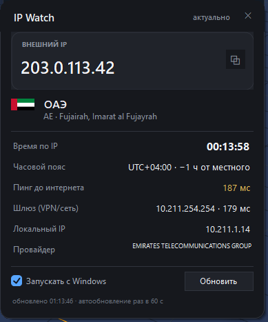

# IP Watch



Маленькая программа для Windows, которая тихо живёт в системном трее и показывает,
под каким внешним IP и из какой страны вы сейчас в интернете — удобно при работе через VPN.
Иконка в трее — **флаг страны**, в которой находится текущий выходной узел.

**[Русский](#русский)** · **[English](#english)**

---

## Русский

### Возможности

- **Внешний IP** — адрес, который видит интернет (с учётом VPN).
- **Страна и флаг** выходного узла + город/регион.
- **Время по IP** — живые часы в часовом поясе этого адреса и смещение от вашего (`UTC+04:00 · −1 ч от местного`).
- **Пинг до интернета** (ICMP до 1.1.1.1, при блокировке — TCP-замер до 1.1.1.1:443).
- **Шлюз** по умолчанию и пинг до него, **локальный IP**, **провайдер**.
- Трей-иконка: **флаг страны** + точка качества связи (зелёная / жёлтая / красная).
- Подсказка при наведении: `IP · страна · время · пинг`.
- Обновление раз в минуту (IP и пинг) и сразу после смены сети/VPN; полные геоданные — при смене IP или раз в 15 минут.
- Автозапуск при входе в Windows, без прав администратора.
- Один самодостаточный `.exe`, без консоли и без установленного .NET.

### Трей


### Установка (другой компьютер)

**Вариант 1 — готовый exe (проще всего)**

1. Откройте [Releases](https://github.com/Mmitekk/IPWatch/releases/latest).
2. Скачайте `IPWatch.exe`.
3. Запустите. Программа появится в трее и при первом запуске сама включит автозапуск.

Если иконки не видно, она могла попасть в переполнение трея (стрелка `^`) — перетащите её на видимую часть.

**Вариант 2 — из репозитория**

```powershell
git clone https://github.com/Mmitekk/IPWatch.git
cd IPWatch
powershell -ExecutionPolicy Bypass -File tools\install.ps1
```

Скрипт скопирует программу в `%LOCALAPPDATA%\Programs\IPWatch`, включит автозапуск,
создаст ярлык в меню «Пуск» и запустит её в трее. Если локальной сборки нет,
`install.ps1` скачает exe из последнего релиза.

**Удаление**

```powershell
powershell -ExecutionPolicy Bypass -File tools\uninstall.ps1
```

Или вручную: выключить «Запускать с Windows» в меню трея, затем удалить папку
`%LOCALAPPDATA%\Programs\IPWatch`.

### Управление

- **Левый клик** по иконке — открыть/закрыть карточку.
- **Правый клик** — меню: показать окно, обновить, копировать IP, автозапуск, выход.
- **Esc** или клик мимо карточки — свернуть в трей.
- Кнопка «копировать» в карточке IP.

### Сборка из исходников

Нужен .NET SDK 9:

```powershell
dotnet publish -c Release -r win-x64 --self-contained true `
  -p:PublishSingleFile=true -p:IncludeNativeLibrariesForSelfExtract=true `
  -p:EnableCompressionInSingleFile=true -p:DebugType=none -o dist
```

### Приватность

Программа не отправляет никуда ничего, кроме запросов к публичным сервисам
определения IP (ipwho.is, при сбое — ip-api.com / ipapi.co) и загрузки флага страны
с flagcdn.com. Локальные данные не собираются и не передаются.

### Структура

| Файл | Назначение |
|---|---|
| `Program.cs` | точка входа, единственный экземпляр, первый запуск |
| `MainForm.cs` | карточка, трей, меню, автозапуск |
| `IpLookupService.cs` | определение внешнего IP и геоданных |
| `NetworkService.cs` | шлюз по умолчанию, локальный IP, пинги |
| `IpInfo.cs` | модель данных, часовые пояса, русские названия стран |
| `FlagCache.cs` | загрузка и кеш флагов стран |
| `TrayIconFactory.cs` | иконки трея: флаг страны + индикатор связи |
| `DarkCheckBox.cs` | чекбокс под тёмную тему |

---

## English

A small Windows tray app that quietly shows your current external IP, country,
local time at that IP, ping and gateway — handy when you use a VPN.
The tray icon is the **flag of the exit country**.

### Features

- **External IP** as seen by the internet (VPN included).
- **Country and flag** of the exit node, plus city/region.
- **Time at the IP** — live clock in that timezone and the offset from yours
  (`UTC+04:00 · −1 h from local`).
- **Internet ping** (ICMP to 1.1.1.1, TCP fallback to 1.1.1.1:443).
- **Default gateway** and its ping, **local IP**, **ISP**.
- Tray icon: **country flag** + link-quality dot (green / yellow / red).
- Hover tooltip: `IP · country · time · ping`.
- Refreshes every minute (IP and ping) and immediately after network/VPN changes; full geo data is refreshed when the IP changes or every 15 minutes.
- Starts with Windows, no administrator rights required.
- A single self-contained `.exe`, no console window, no .NET installation needed.

### Install (another PC)

**Option 1 — ready-made exe (easiest)**

1. Open [Releases](https://github.com/Mmitekk/IPWatch/releases/latest).
2. Download `IPWatch.exe`.
3. Run it. It appears in the tray and enables autostart on first launch.

If you don't see the icon, it may be in the tray overflow area (the `^` arrow) —
drag it onto the visible part of the taskbar.

**Option 2 — from the repository**

```powershell
git clone https://github.com/Mmitekk/IPWatch.git
cd IPWatch
powershell -ExecutionPolicy Bypass -File tools\install.ps1
```

The script copies the app to `%LOCALAPPDATA%\Programs\IPWatch`, enables autostart,
creates a Start-menu shortcut and launches it in the tray. If no local build exists,
`install.ps1` downloads the exe from the latest release.

**Uninstall**

```powershell
powershell -ExecutionPolicy Bypass -File tools\uninstall.ps1
```

Or manually: turn off "Start with Windows" in the tray menu and delete
`%LOCALAPPDATA%\Programs\IPWatch`.

### Usage

- **Left click** the tray icon — show/hide the card.
- **Right click** — menu: show window, refresh now, copy IP, autostart, exit.
- **Esc** or click outside — hide to tray.
- The copy button in the IP card copies the address.

### Build from source

Requires .NET SDK 9:

```powershell
dotnet publish -c Release -r win-x64 --self-contained true `
  -p:PublishSingleFile=true -p:IncludeNativeLibrariesForSelfExtract=true `
  -p:EnableCompressionInSingleFile=true -p:DebugType=none -o dist
```

### Privacy

The app only contacts public IP-lookup services (ipwho.is, falling back to
ip-api.com / ipapi.co) and flagcdn.com for country flags. No local data is
collected or sent anywhere.
